# Papero

**Papero** 是世界语里的「纸」。它是一个以 Markdown 为主、但不止 Markdown 的个人知识库。

窗口结构是「整宽标题栏 + 左侧栏 + 一张纸」：

- **标题栏**：侧栏开关、快速跳转、命令面板，以及 文件 / 编辑 / 视图 / 帮助 菜单；
  macOS 用系统红绿灯，其他平台自绘窗口按钮
- **左侧栏**：顶部是软件名，下面是动作（新建文稿 / 快速搜索 / 打开知识库 / 知识图谱 / 发现）、
  文档 / 大纲 / 链接的切换与目录树，底部是最近打开、工作区间与设置
- **文稿区**：一张圆角卡片，标签在卡片顶部，保存状态、编码、行数与显示方式在卡片底部

用 Go 和 [MyGo](https://github.com/egoist/mygo) 写成：窗口、排版、编辑器、白板全部由 Go
在 GPU 上原生绘制，**没有 WebView、没有 Electron、没有 JavaScript**。一个可执行文件，
双击就能用。

> **平台：只在 Windows 上实机测过。**
> 代码能编出 Linux（amd64）和 macOS（arm64）的二进制，但不代表能用——没有在真机上
> 启动过、没有点过一个菜单，测试也只覆盖 Windows 的行为。
> 非 Windows 平台请当实验版本看，出问题属于预期之内。

起始页把最常用的三个动作和「最近打开」摆在中间，空窗口也有事可做：

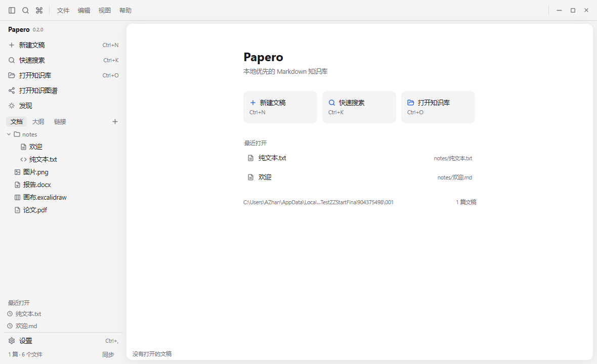

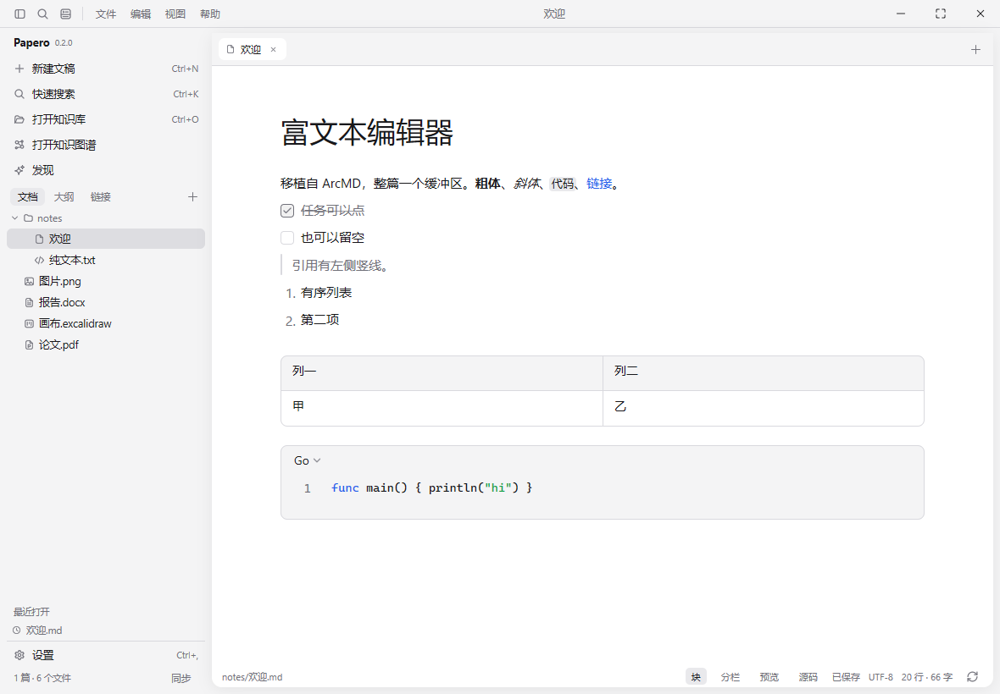

公式用 TeX 排版：行内 `$…$` 跟着基线走，块级公式各自居中
（分数线、根号、上下标、求和上下限、cases 都对）：

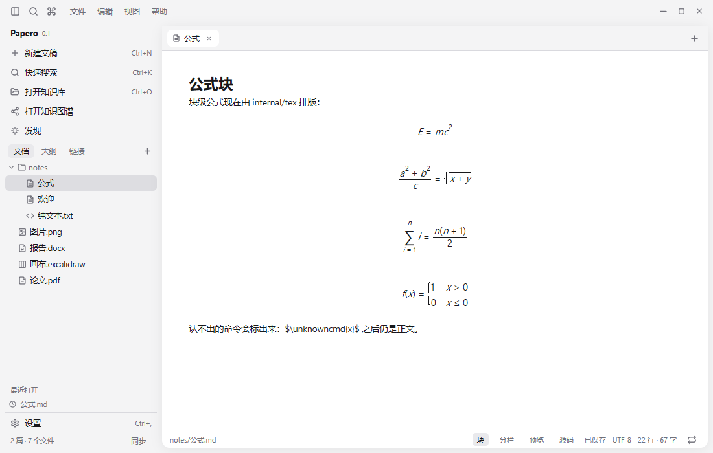

空块里打一个 `/` 就弹出插入菜单：顶部是按类型上色的图标网格，下面是代码块、公式、
分隔线、表格，都带 Markdown 快捷写法提示，↑/↓ 选择、回车插入、输入即过滤：

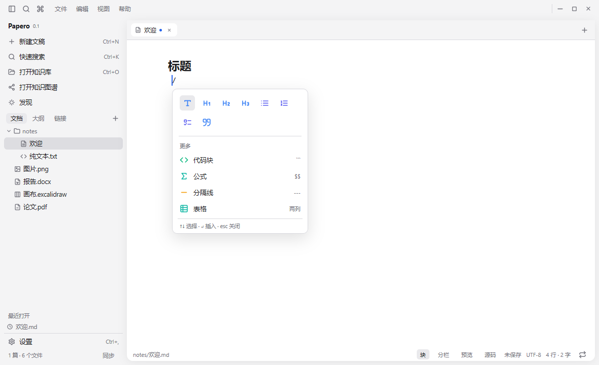

拖块左侧的把手可以整块上下移动（往右拖就嵌进上一项，Tab / Shift+Tab 也能调缩进），
Shift 点击可多选、Delete 批量删；落点有一条强调色细线：

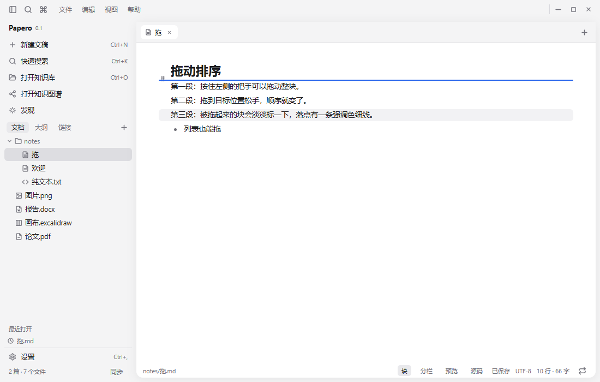

点任意一块就编辑它的 Markdown 源码——**光标落在你点的那个字上**，其余块保持排版（Esc 退出）：

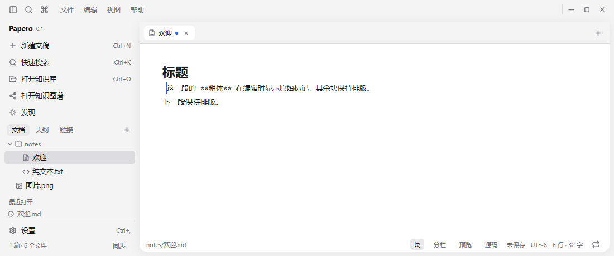

分栏模式下的源码编辑器也有实时排版（标记藏起来、标题放大、任务框可点）：

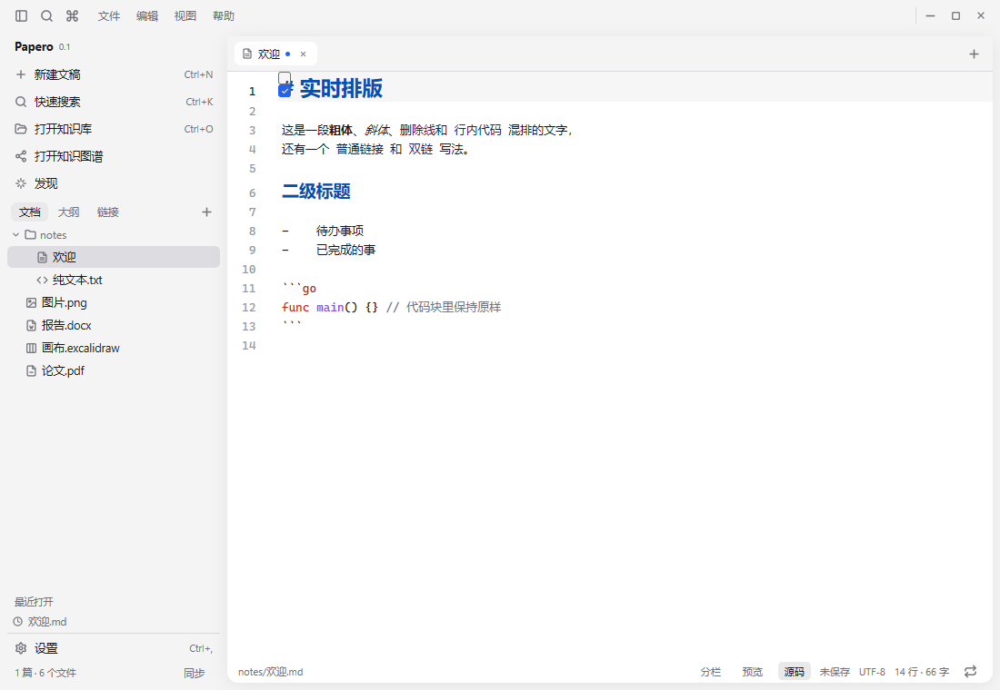

外观是中性灰的界面 + 白纸正文，字体用系统的无衬线（源码用等宽），深浅色跟随桌面：

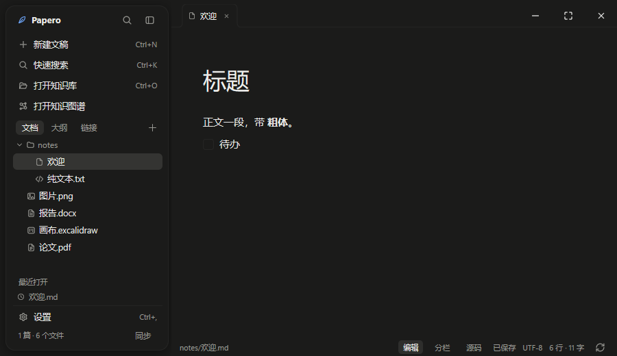

双链生成的知识图谱（用 Onevra 的关系图谱组件绘制，按目录分组着色、悬停高亮邻居），
可以嵌在主窗口里，也可以在设置里改成独立窗口：

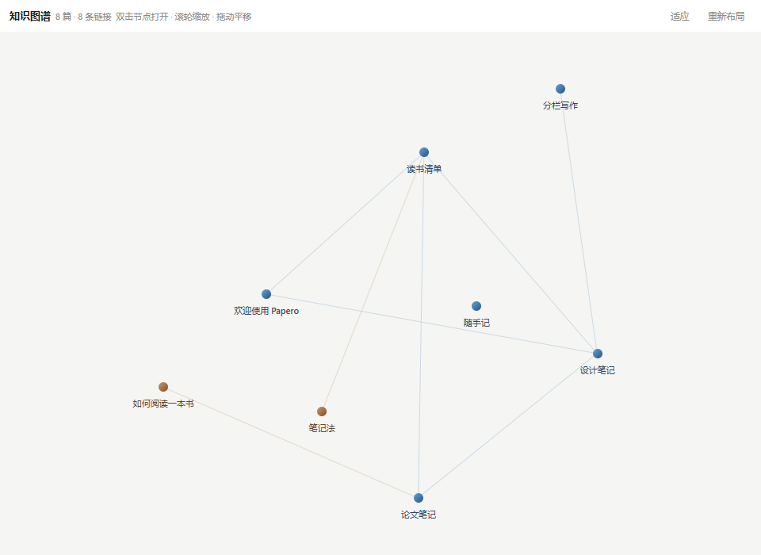

输入 `[[` 时自动补全，第一条永远是「新建」——写一个新名字就能连到还不存在的笔记：

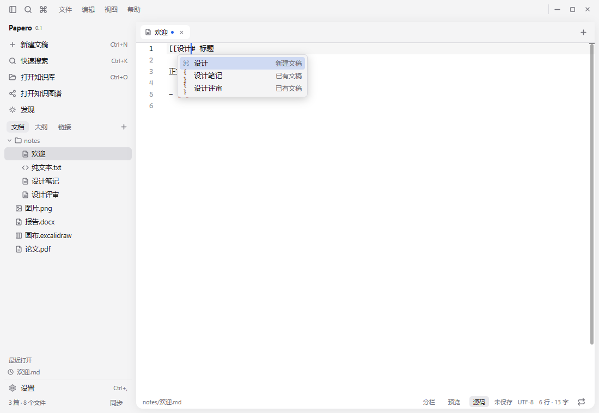

删掉一篇被引用的笔记会先提醒，断链也不会丢内容：

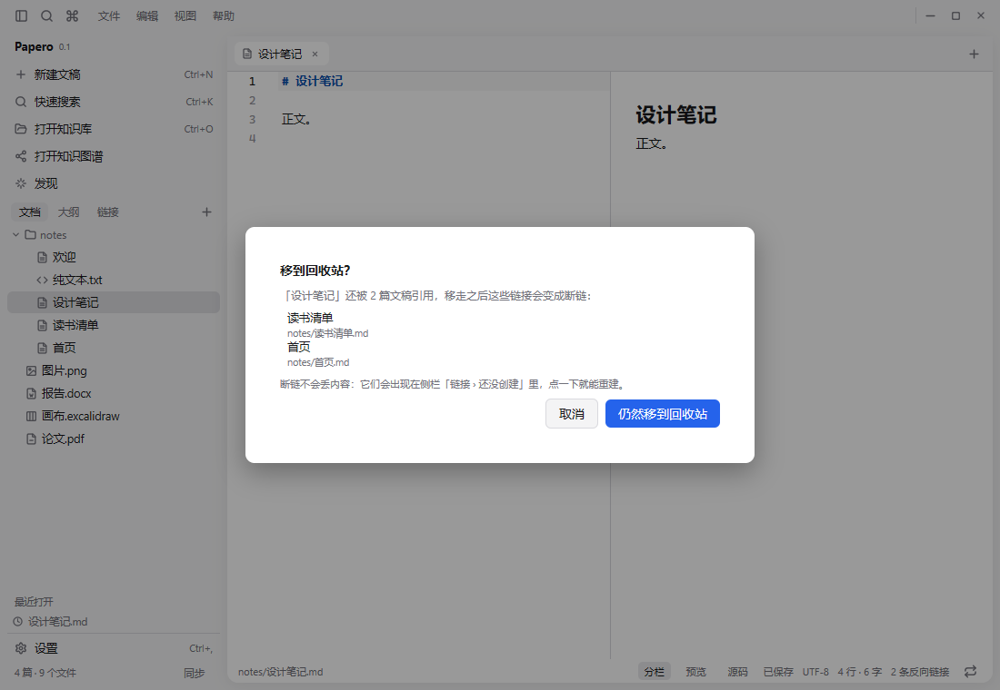

| PDF：原生解析重排 | 白板：Excalidraw 互通 |
| --- | --- |
设置是独立窗口，左侧分页：通用（知识库与外观）、编辑器（默认显示方式与写作操作）、同步、插件、关于：

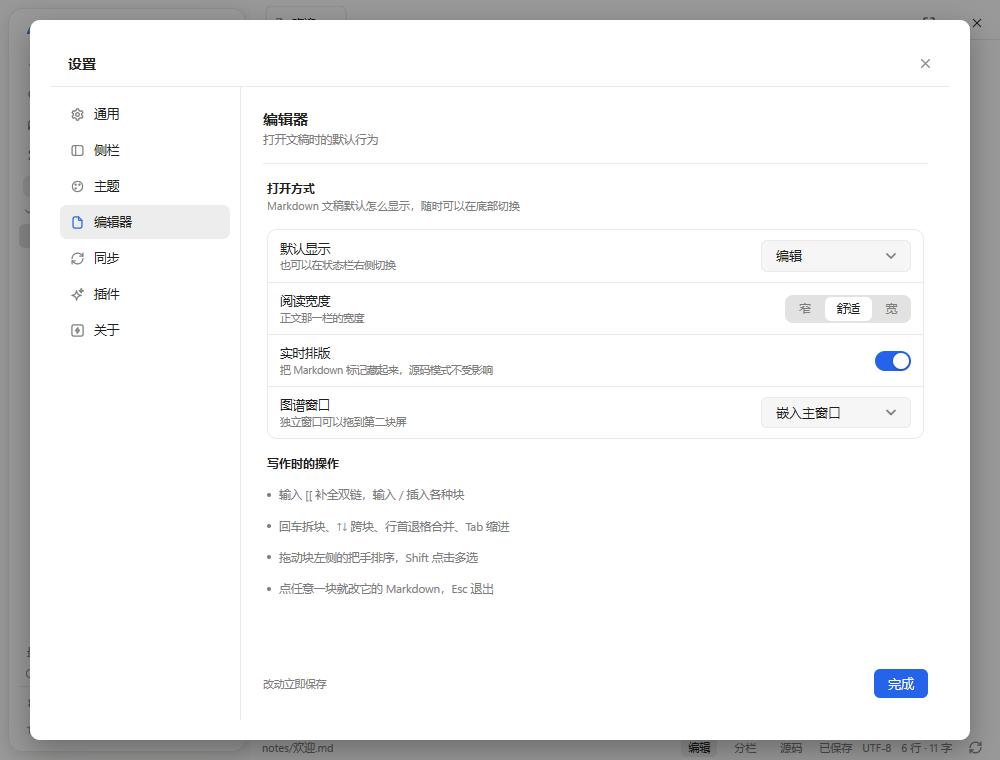

| 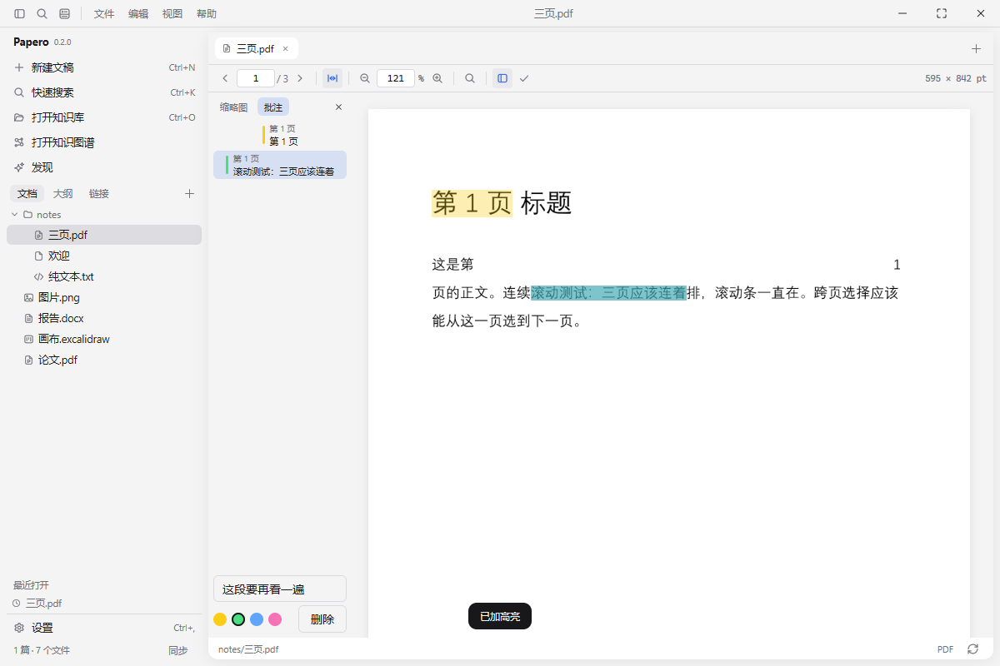 | 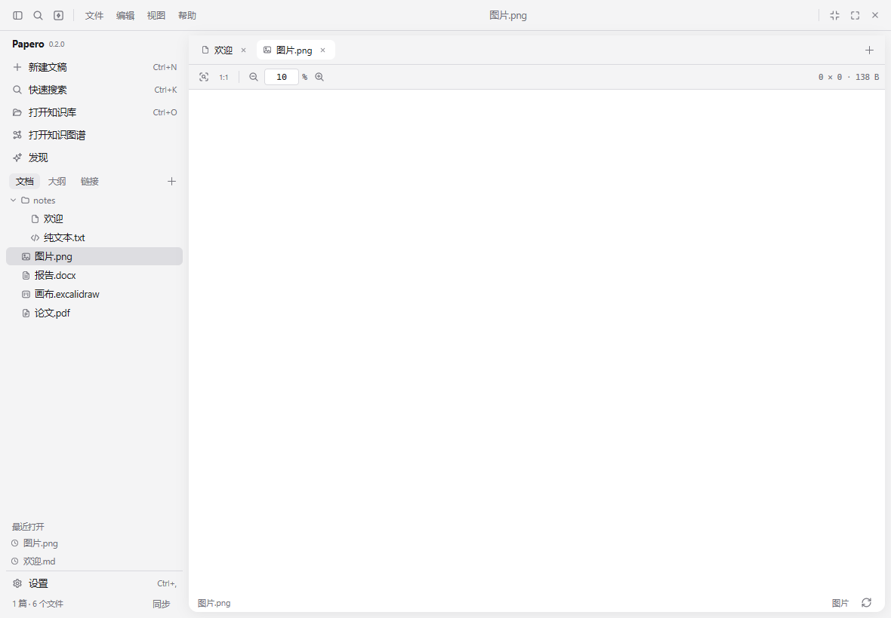 |

## 它能打开什么

| 类型 | 能力 |
| --- | --- |
| **Markdown** | 分栏（源码 + 实时预览）、纯预览、纯源码；语法高亮、任务框可点、图片内联、公式与表格 |
| **图片** | PNG / JPEG / GIF / WebP / BMP / SVG，适应窗口、1:1、缩放 |
| **PDF** | 纯 Go 解析内容流，按原版面位置重排文字与图片，可翻页、可缩放、文字可选中 |
| **Word** | `.docx` 直接读成 Markdown 排版（标题、粗斜体、列表、表格） |
| **纯文本** | 代码、日志、CSV，按扩展名高亮 |
| **白板** | `.excalidraw` 原生绘制与编辑，与 Excalidraw 文件互通（`Ctrl+Shift+P` › 新建白板） |

还有两条把笔记连起来的线索：

- **双链**：正文里写 `[[另一篇]]`、`[[另一篇|别名]]`、`[[另一篇#标题]]`，
  输入 `[[` 会自动列出库里的文稿补全；点击跳转（目标不存在就地新建）；
  **改名时自动更新全库引用**（保留别名与锚点），**删除前告诉你哪些笔记会被断链**；
  侧栏「链接」页列出反向链接、出链与还没创建的链接，**指针停在链接上就能预览目标开头**，
  断链可以一键全部建成空文稿；预览里右键链接也能打开 / 新建
- **知识图谱**：侧栏「打开知识图谱」（就在「打开知识库」下面）直接打开，
  按双链自动布局、按目录分组着色，双击节点跳到那篇文稿；
  在设置里可以选「嵌入主窗口」或「独立窗口」

## 三条设计原则

1. **文稿就是文件。** 知识库是一个普通文件夹，笔记就是普通的 `.md`。
   没有私有数据库、没有专有格式，随时可以和 Obsidian、VS Code、Git 共用同一个目录，
   卸载 Papero 也不会带走你的笔记。
2. **原生，不套壳。** 不用 WebView 换开发速度。界面由 `ui` 包在 GPU 上绘制，
   启动快、内存小、输入延迟低，跨平台一套代码。
3. **核心轻，能力靠插件。** 核心只负责「打开、显示、编辑、同步」。
   白板、看板、AI 写作这些通过插件加入，用户可以自己选择装什么。

## 运行

需要 Go 1.27.3+（MyGo 的要求）：

```sh
go run .                     # 启动
go test ./...                # 跑测试
go run . -shot preview.png   # 把界面渲染成 PNG（开发辅助）
go build -o papero .         # 构建
```

首次启动会在 `~/Documents/Papero`（Windows 为 `文档\Papero`）建一个知识库，
放一篇欢迎文稿。用 `Ctrl+O` 可以换成任何已有文件夹。

### 快捷键

| 键 | 作用 |
| --- | --- |
| `Ctrl+K` / `Ctrl+P` | 快速跳转到任意文稿 |
| `Ctrl+Shift+P` | 命令面板（所有操作都能在这里找到） |
| `Ctrl+\` | 收起 / 展开侧栏 |
| 中键点击标签 | 关闭这个标签 |
| 右键文稿 / 目录 / 标签 | 打开、重命名、复制路径、移到回收站等 |
| `Ctrl+N` | 新建文稿 |
| `Ctrl+S` | 保存（也有 800ms 自动保存） |
| `Ctrl+W` | 关闭当前标签 |
| `Ctrl+O` | 打开另一个知识库文件夹 |
| `Ctrl+,` | 设置 |
| `Ctrl+Shift+R` | 重新扫描知识库 |

## 构建

Windows 上要带 `-H windowsgui`，否则双击启动会先弹一个黑色终端窗口：

```bash
make build          # 等价于 go build -trimpath -ldflags="-H windowsgui -s -w" -o build/papero.exe .
```

推 `v*` 标签时 GitHub Actions（`.github/workflows/release.yml`）会先跑一遍
`fmt / vet / test`，再把三个平台的二进制发到 Release 上：
`papero-windows-amd64.exe`、`papero-linux-amd64`、`papero-darwin-arm64`。
后两个只验证到「编得过」——没有实机跑过，原因见开头的平台说明。

### 安装包

`make build` 只出裸 exe。要出安装包用 MyGo 自己的打包器（会顺带处理图标、版本号、
文件关联）：

```bash
go install github.com/egoist/mygo/cmd/mygo@v0.10.0

mygo build -platform windows/amd64
# → build/windows-amd64/Papero.exe
#   build/windows-amd64/papero-setup-<版本>-amd64.exe
```

安装包用 NSIS 生成，第一次跑会自动下载 NSIS；`-skip-installer` 可跳过。
应用名、版本、图标、文件关联都在 `mygo.json` 里，改版本时记得和
`internal/app/settings.go` 的 `appVersion` 一起改。

图标源文件在 `design/icons/`（SVG + 各尺寸 PNG）。构建取
`png-flat/papero-flat-1024.png`（无底色版）；`png-v6/` 是带米色底的旧版，留作对比。`resources/` 会被整个复制进安装目录，
所以设计源不放在那里。

## 目录

| 目录 | 放什么 | 进版本库 |
| --- | --- | --- |
| `internal/` | 全部 Go 代码 | 是 |
| `docs/` | 架构、插件、同步、路线图；`docs/images/` 是文档用图 | 是 |
| `design/icons/` | 当前图标源：3 个 SVG + `png-flat/` 各尺寸导出 | 是 |
| `build/` | **只有构建产物**：`papero.exe`、`papero-setup-*.exe` | 否 |
| `tmp/` | 截图、诊断渲染等临时文件 | 否 |

截图放在 `tmp/shots/`，不要往 `build/` 里放——那是产物目录。

## 代码结构

```
papero/
├── main.go                    入口：启动窗口，或渲染截图
├── mygo.json                  应用名、文件关联、打包配置
├── internal/
│   ├── app/                   窗口装配：侧栏、标签、查看器、浮层
│   │   ├── app.go             状态与动作（打开、保存、新建、切换知识库）
│   │   ├── view.go            主布局、快捷键、状态栏
│   │   ├── sidebar.go         目录树
│   │   ├── content.go         按类型分派到各个查看器
│   │   ├── pdfview.go         PDF 查看器（连续滚动、缩略图、批注）
│   │   ├── board.go           白板查看器与编辑交互
│   │   ├── overlays.go        快速跳转、设置面板
│   │   └── shot.go            无窗口渲染，用于检查外观
│   ├── vault/                 知识库：扫描成树、类型识别、安全读写
│   ├── pdf/                   PDF 解析：xref、对象流、字体、内容流、图片
│   ├── docx/                  .docx → Markdown
│   ├── plugin/                插件清单、安装、宿主契约
│   ├── board/                 白板：Excalidraw 场景的读写与命中测试
│   ├── wiki/                  双链解析与全库链接图
│   ├── richdoc/               Markdown 富文档模型与导入导出（改编自 ArcMD）
│   ├── tex/                   TeX 排版（ArcMD 的 math 块用）
│   ├── sync/                  文件级三方同步：文件夹 / Git / 本库仓库 / WebDAV 四种远端
│   ├── theme/                 三个颜色（背景 / 前景 / 强调）派生全部界面配色
│   ├── i18n/                  界面中英对照：每条文案一个稳定 key，缺了显示 key
│   └── config/                本机设置
```

设计细节见 [docs/architecture.md](docs/architecture.md)，
插件规范见 [docs/plugins.md](docs/plugins.md)，
同步算法见 [docs/sync.md](docs/sync.md)，
进度与后续计划见 [docs/roadmap.md](docs/roadmap.md)。

## 现状

这是 **0.2**：能日常用来读笔记、看论文、画白板；界面配色可换（三个颜色派生全套），
界面可切中英文，设置页翻新，出 Windows 安装包，自带更新（关于页 → 检查更新；
有新版本时侧栏底部出提示，点开是**从当前版本到新版本之间每一版**的更新日志）。Markdown 的所见即所得编辑、
插件市场、PDF 像素级还原还在路上，详见 [docs/roadmap.md](docs/roadmap.md)。

**只在 Windows 上实机验证过**：Linux 与 macOS 的二进制能编出来，但没有启动过。
自更新这一版只跑了单元测试和界面，还没有拿真实的 release 走通过一次完整升级。

## 许可证

MIT。图标分两套：窗口外壳来自 [IconMCP](https://iconmcp.com)（MIT，16 格网格），
编辑器浮动工具条来自 [Lucide](https://lucide.dev)（ISC，24 格网格），
明细见 [NOTICE.md](NOTICE.md)。应用图标（纸质小鸭）为自有设计，
源文件在 `design/icons/`。UI 与窗口能力来自 [MyGo](https://github.com/egoist/mygo)（MIT）。

`LICENSE` 与 `NOTICE.md` 会随安装包装进安装目录（`mygo.json` 的 `resources`）——
MIT / ISC 都要求分发时保留这些声明，所以它们不是可有可无的附件。
